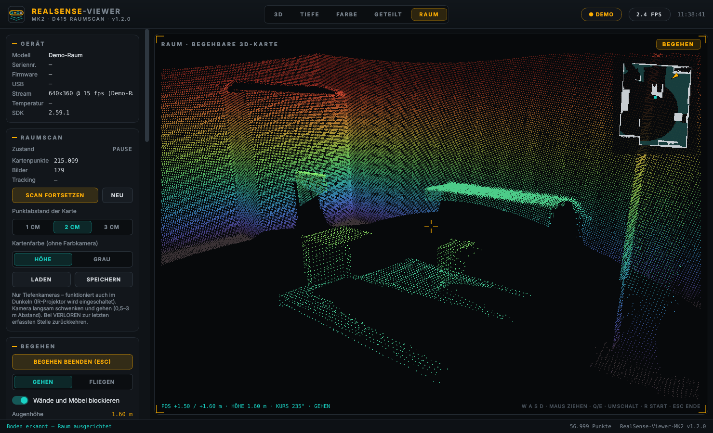

# RealSense-Viewer-MK2

**Version 1.3.1** · reines Desktop-Programm für Windows und macOS auf Apple Silicon (kein Browser, kein Webserver)

Zeigt das 3D-Bild einer per USB angeschlossenen **Intel RealSense D415** live in einem eigenen Programmfenster an – im Design der Dashboards (dunkel, Amber/Teal). Neu in MK2: **Raumscan**. Man trägt die Kamera durch den Raum, das Programm setzt alle Bilder zu einer zusammenhängenden 3D-Karte zusammen – und durch diese Karte kann man anschließend **wie in einem virtuellen Raum gehen und sich umsehen** – mit Tastatur und Maus oder mit einer **3Dconnexion-3D-Maus**. Der Scan nutzt **nur die Tiefenkameras** (Stereo-IR) und funktioniert daher auch in **völliger Dunkelheit**.



*Begehen-Modus im eingebauten Demo-Raum, Kartenfarbe „Höhe“: Ich-Perspektive in Augenhöhe, rechts oben die Minikarte mit eigener Position und Blickrichtung.*

## Raumscan und Begehen (neu in MK2)

1. Reiter **RAUM** öffnen (Taste 5) und **SCAN STARTEN** drücken.
2. Kamera **langsam** schwenken und durch den Raum tragen, Abstand zu den Flächen 0,5–3 m. Rechts oben läuft das Live-Tiefenbild mit, die Karte wächst mit; die türkise Linie zeigt den bisherigen Weg der Kamera.
3. Erscheint **TRACKING VERLOREN**, die Kamera auf einen **beliebigen bereits gescannten Bereich** richten (z. B. Schreibtisch mit Tastatur und Monitor) – aus ähnlichem Blickwinkel wie beim Scannen. Das Programm sucht unter allen früheren Ansichten die passendste heraus, legt das Bild an und prüft das Ergebnis gegen die gesamte Karte, bevor es weitermacht. So rastet es nicht an einer ähnlich aussehenden, aber falschen Wand ein.
4. **SCAN PAUSIEREN**, dann **RAUM BEGEHEN** (Taste B). Der Boden wird automatisch erkannt und waagerecht ausgerichtet, man steht in Augenhöhe am Startpunkt des Scans.

### Nur Tiefe – auch im Dunkeln

Während der Scan läuft, betreibt das Programm die D415 **ohne Farbstrom**: Der Farbsensor wird abgeschaltet, der IR-Projektor eingeschaltet, und das Tracking rechnet ausschließlich mit den Tiefendaten der beiden IR-Kameras. Licht wird dafür nicht gebraucht – das Projektor-Muster liefert die nötige Struktur. Beim Pausieren schaltet die Kamera den Farbstrom wieder zu (dabei startet sie kurz neu).

Da es keine echten Farben gibt, wird die Karte aus der Form eingefärbt (**Kartenfarbe**):

- **HÖHE** – Farbskala nach Höhe über dem Boden, schattiert. Gut zur Orientierung.
- **GRAU** – neutral schattiert, wirkt wie ein Gipsmodell.

### Steuerung beim Begehen

| Eingabe | Funktion |
|---|---|
| W A S D / Pfeil hoch, runter | gehen, seitwärts gehen |
| Pfeil links / rechts | drehen |
| Maus ziehen (linke Taste) | umsehen |
| Mausrad | Schritt vor / zurück |
| Umschalt (gedrückt halten) | schneller |
| Q / E | runter / hoch (im Modus Fliegen) |
| F | zwischen **Gehen** und **Fliegen** wechseln |
| R | zurück zum Startpunkt |
| Esc | Begehen beenden |

### 3Dconnexion-3D-Maus

SpaceMouse, SpaceNavigator, SpacePilot u. Ä. funktionieren beim Begehen zusätzlich zu Tastatur und Maus – einfach anschließen, keine weitere Einrichtung nötig (das Programm liest das Gerät unter Windows direkt über *Raw Input*; der 3DxWare-Treiber darf installiert sein).

| Kappe | Funktion |
|---|---|
| von sich weg schieben / heranziehen | vorwärts / rückwärts gehen |
| nach links / rechts schieben | seitwärts gehen |
| im / gegen den Uhrzeigersinn drehen | nach rechts / links drehen |
| nach vorn / hinten neigen | nach unten / oben sehen |
| anheben / herunterdrücken | hoch / runter (Modus Fliegen) |
| linke Taste | zurück zum Startpunkt |
| rechte Taste | Gehen / Fliegen wechseln |

Im Feld **3D-MAUS** der Seitenleiste stehen Gerätestatus und die sechs Achsen live (zum Prüfen der Richtungen), dazu Empfindlichkeit und Schalter zum Umkehren von Vor/Zurück, Neigen und Drehen. Weitere Achsen lassen sich in der config.ini umkehren. Die 3D-Maus wirkt nur, solange das Programmfenster im Vordergrund ist. Hat 3DxWare die beiden Tasten mit eigenen Funktionen belegt (z. B. Menü), kommen sie im Programm unter Umständen nicht an – dann in den 3DxWare-Einstellungen für dieses Programm die Tastenbelegung zurücksetzen.

- **Gehen:** feste Augenhöhe über dem Boden; mit „Wände und Möbel blockieren“ kann man nicht durch gescannte Hindernisse laufen, man gleitet an ihnen entlang.
- **Fliegen:** frei in alle Richtungen, auch durch Wände und über Möbel.
- **Augenhöhe, Gehtempo, Punktgröße beim Begehen** sind in der Seitenleiste einstellbar. Die Punkte haben beim Begehen eine feste Bildschirmgröße (Standard 2 px, wie in der Scan-Ansicht) – auch direkt vor einer Wand werden sie nicht größer.
- **Minikarte** rechts oben: Grundriss aus dem Scan, Amber-Pfeil = eigene Position und Blickrichtung, türkiser Punkt = Startpunkt.

### Raum speichern und laden

- **SPEICHERN** (Strg+Umschalt+S) legt den Raum als PLY-Punktwolke ab – bereits am Boden ausgerichtet, mit Startpunkt. Die Datei lässt sich auch in MeshLab, CloudCompare oder Blender öffnen.
- **LADEN** (Strg+O) öffnet einen gespeicherten Raum zum Begehen – dafür muss keine Kamera angeschlossen sein. Auch andere PLY-Dateien (z. B. Einzelbilder aus *Punktwolke speichern*) lassen sich laden.
- **Punktabstand der Karte:** 1 cm (fein, mehr Speicher), 2 cm (Standard) oder 3 cm (große Räume). Gilt ab dem nächsten Scan (**NEU**).

### Ohne Kamera ausprobieren

Ist keine D415 angeschlossen, liefert das Programm einen **Demo-Raum**: ein möbliertes Zimmer, durch das eine virtuelle Kamera langsam geht. Damit lassen sich Scan, Speichern und Begehen vollständig testen.

### So funktioniert der Scan

Jedes Tiefenbild wird per ICP (Punkt-zu-Ebene, grob-nach-fein) an ein Schlüsselbild angelegt. Daraus ergibt sich die Bahn der Kamera, mit der Punkte und Flächennormalen in eine gemeinsame Voxel-Karte eingetragen und gemittelt werden. Jedes Schlüsselbild wird platzsparend mit einem groben Tiefen-Fingerabdruck gespeichert; nach einem Abbruch werden darüber die ähnlichsten früheren Ansichten gesucht und der Treffer erst übernommen, wenn mindestens 55 % der aktuellen Punkte auf bereits kartierten Flächen liegen. Alles läuft in einem eigenen Thread, ohne zusätzliche Bibliotheken (nur numpy). Die D415 hat keinen Bewegungssensor, und der Scan nutzt bewusst nur die Form des Raums – er braucht daher räumliche Struktur im Bild: Möbel, Kanten, Ecken und Gegenstände helfen. Sieht die Kamera längere Zeit nur eine glatte Wand und den Boden, kann sich die Karte entlang dieser Flächen um einige Zentimeter verschieben; dann etwas mehr Raum ins Bild nehmen.

## Weitere Funktionen (aus MK1)

- **3D-Punktwolke** in OpenGL: linke Maustaste drehen, mittlere Maustaste verschieben, Mausrad zoomen
- Ansichten: **3D · Tiefe · Farbe · Geteilt · Raum** (Tasten 1–5)
- Punktfarbe: echtes **RGB** der Kamera, **Tiefen-Farbskala** (mit Legende), Amber oder Teal
- Distanzbereich (min./max.), Punktgröße, Punktabstand (1–4 Pixel), Bodenraster, Kamerasymbol mit Sichtkegel
- Blickwinkel: Kamera, Schräg, Oben, Seite
- Kamera: Auflösung (bis 1280×720), Bildrate, IR-Projektor an/aus, Laserleistung, Preset (z. B. High Accuracy / High Density)
- Filter des RealSense-SDK: räumliche und zeitliche Glättung, Löcher füllen
- Geräteinfo: Modell, Seriennummer, Firmware, USB-Typ (Warnung bei USB 2), Temperatur, FPS
- Tiefenbild: Mauszeiger zeigt die Entfernung des Pixels in Metern
- Einzelbild als **PLY** speichern, Bild als PNG, Einfrieren
- Dunkle Windows-Titelleiste, Fenstergröße wird gemerkt
- Alle Einstellungen in der menschenlesbaren **config.ini** neben der exe

### Tastenkürzel

| Taste | Funktion |
|---|---|
| 1 / 2 / 3 / 4 / 5 | Ansicht 3D / Tiefe / Farbe / Geteilt / Raum |
| B | Raum begehen an/aus |
| Strg+O | Raum laden |
| Strg+Umschalt+S | Raum speichern |
| Leertaste | Einfrieren / Fortsetzen |
| Strg+S | Einzelbild-Punktwolke als PLY speichern |
| Strg+P | Bild als PNG speichern (auch aus der Raumansicht) |
| F11 | Vollbild |

## Seitenleiste je Ansicht

Die Seitenleiste zeigt nur die Einstellungen, die in der gerade gewählten Ansicht etwas bewirken:

| Ansicht | Panels |
|---|---|
| 3D, Geteilt | Gerät, Kamera, Verarbeitung, Darstellung, Aufnahme, System |
| Tiefe | Gerät, Kamera, Verarbeitung, Aufnahme (ohne Darstellung) |
| Farbe | Gerät, Kamera (ohne Projektor/Preset), Verarbeitung (nur Punktabstand), Aufnahme (Einfrieren, PNG) |
| Raum | Gerät, Raumscan, Begehen, 3D-Maus (Windows), Kamera, Verarbeitung (ohne Distanzbereich), Darstellung (Punktgröße, Bodenraster), Aufnahme (PNG) |

## Benutzung (Windows 10/11)

1. Zip entpacken, `RealSense-Viewer-MK2.exe` starten (der erste Start dauert einige Sekunden, weil die exe sich entpackt).
2. Die D415 an einen **USB-3-Port** anschließen. An USB 2 funktionieren nur kleine Auflösungen.

Ein separater Treiber ist nicht nötig – die RealSense-Bibliothek steckt in der exe. Wird die Kamera nicht erkannt: Kabel/Port wechseln, andere Programme schließen, die die Kamera benutzen (z. B. Intel RealSense Viewer), dann **„Kamera neu verbinden“** klicken.

Probleme werden in `realsense-viewer.log` neben der exe protokolliert – dort stehen auch alle Formate, die die Kamera anbietet, und welches gewählt wurde.

### Kamera wird erkannt, aber kein Bild

- **USB 2 statt USB 3:** Im Feld *USB* steht dann `2.x`. Die D415 schafft an USB 2 nur kleine Auflösungen (z. B. 640×480 @ 30). Das Programm wählt automatisch ein passendes Format; für volle Auflösung einen USB-3-Port (blau / SS) und ein USB-3-fähiges Kabel nutzen – viele USB-C-Kabel sind nur USB 2.
- **Windows-Datenschutz:** *Einstellungen → Datenschutz & Sicherheit → Kamera* → „Kamerazugriff“ und „Desktop-Apps den Zugriff auf die Kamera erlauben“ einschalten.
- **Kamera belegt:** Intel RealSense Viewer, Teams, OBS o. Ä. schließen.

### Tipps für einen guten Raumscan

- Langsam bewegen – lieber drehen als schnell gehen. Die Anzeige *Tracking* in der Seitenleiste zeigt Bilder pro Sekunde und die Übereinstimmung in Prozent.
- Möbel, Ecken und Kanten im Bild halten, nicht nur eine glatte Wand.
- IR-Projektor nicht ausschalten – im Dunkeln liefert die D415 ohne ihn keine Tiefe (beim Scan wird er automatisch eingeschaltet).
- Glättung (räumlich/zeitlich) eingeschaltet lassen; *Max. Distanz* hat keinen Einfluss auf den Scan (dieser nutzt 0,2–3,5 m).
- Den Boden mit erfassen (Kamera leicht nach unten neigen) – sonst kann die Augenhöhe beim Begehen nur geschätzt werden.

## Benutzung (macOS, Apple Silicon)

1. `RealSense-Viewer-MK2_v…_Mac-AppleSilicon.zip` entpacken und `RealSense-Viewer-MK2.app` in den Programme-Ordner ziehen.
2. Die App ist nicht von Apple beglaubigt. Beim ersten Start daher **Rechtsklick → Öffnen**. Meldet macOS „beschädigt“, einmal im Terminal ausführen:
   `xattr -dr com.apple.quarantine /Applications/RealSense-Viewer-MK2.app`
3. config.ini, Protokoll und Selbsttest liegen unter `~/Library/Application Support/RealSense-Viewer-MK2/` (Knopf *DATENORDNER ÖFFNEN*).
4. **Kamera unter macOS:** Die RealSense-Bibliothek greift direkt per USB auf die D415 zu; auf neueren macOS-Versionen klappt das oft nur mit Administratorrechten. Wird die Kamera nicht erkannt, die App aus dem Terminal starten:
   `sudo /Applications/RealSense-Viewer-MK2.app/Contents/MacOS/RealSense-Viewer-MK2`
   Ohne Kamera läuft der Demo-Raum; gespeicherte Räume lassen sich jederzeit laden und begehen.
5. Die 3D-Maus-Unterstützung gibt es nur unter Windows; das Panel 3D-MAUS ist auf dem Mac ausgeblendet.

## config.ini

Wird beim ersten Start neben der exe angelegt (Mac: im Datenordner, siehe oben).

| Abschnitt | Schlüssel | Bedeutung |
|---|---|---|
| `[kamera]` | `aufloesung`, `fps` | z. B. `848x480`, `30` |
| `[kamera]` | `seriennummer` | leer = erste Kamera, sonst bestimmte Kamera |
| `[kamera]` | `demo_modus` | `auto` (Demo-Raum ohne Kamera), `nein`, `ja` |
| `[kamera]` | `laser`, `laserleistung`, `preset` | Projektor-Einstellungen |
| `[verarbeitung]` | `punktabstand` | 1 = jeder Pixel, 2 = jeder zweite … |
| `[verarbeitung]` | `min_distanz_m`, `max_distanz_m` | angezeigter Tiefenbereich |
| `[ansicht]` | `farbmodus`, `punktgroesse`, `ansicht` | Darstellung |
| `[raum]` | `voxel_cm` | Punktabstand der Raumkarte: `1`, `2`, `3` |
| `[raum]` | `modus`, `kollision` | `gehen` / `fliegen`, Hindernisse `ja` / `nein` |
| `[raum]` | `augenhoehe_m`, `tempo_m_s`, `punkt_px` | Begehen (Punktgröße in Pixeln) |
| `[raum]` | `farbe` | Kartenfarbe `hoehe` oder `grau` |
| `[3dmaus]` | `aktiv`, `empfindlichkeit` | 3D-Maus beim Begehen |
| `[3dmaus]` | `umkehr_vor`, `umkehr_seite`, `umkehr_hoch`, `umkehr_neigen`, `umkehr_drehen` | Achsen umkehren (`ja`/`nein`) |
| `[fenster]` | `breite`, `hoehe`, `maximiert` | Fenster |

## Bauen per GitHub Actions

1. Inhalt dieser Zip in ein GitHub-Repository hochladen (inkl. Ordner `.github`).
2. Bei jedem Push auf `main`/`master` baut der Workflow **Build Windows EXE und Mac-App (Apple Silicon)** parallel
   - die Windows-exe (`windows-latest`) und
   - die Mac-App für Apple Silicon/arm64 (`macos-15`, App-Paket mit Symbol und Versionsnummer, ad hoc signiert, lauffähig ab macOS 12),

   startet beide mit `--selbsttest` (prüft dabei auch den Raumscan am Demo-Raum und die 3D-Maus-Auswertung) und stellt sie als Artefakte bereit (Reiter *Actions* → Lauf → *Artifacts*).
3. Für ein Release einen Tag setzen, z. B. `git tag v1.3.1 && git push --tags` – dann erscheinen `…_Windows.zip` und `…_Mac-AppleSilicon.zip` unter *Releases*.

Die Versionsnummer steht in `app.py` (`APP_VERSION`) und wird automatisch in exe-Eigenschaften, Zip-Namen und Fenster übernommen.

## Lokal starten (ohne exe)

```bash
pip install -r requirements.txt
python app.py
```

`python app.py --selbsttest` prüft, ob alle Bestandteile vorhanden sind.

## Ordnerstruktur

```
RealSense-Viewer-MK2/
├── app.py                      Programmfenster (PySide6/Qt + pyqtgraph-OpenGL)
├── kamera.py                   Kamera-Thread, Demo-Raum-Anbindung, config.ini
├── raumscan.py                 Tracking (ICP), Voxel-Karte, Bodenerkennung, Hindernisse, PLY
├── raumansicht.py              begehbare 3D-Ansicht (Ich-Perspektive, Minikarte, 3D-Maus-Steuerung)
├── spacemouse.py               3Dconnexion-3D-Maus über Windows Raw Input
├── demoraum.py                 möbliertes Demo-Zimmer für Tests ohne Kamera
├── requirements.txt
├── assets/                     icon.ico, icon.png, logo.svg, pfeil.png
├── docs/screenshot.png         Bild für diese README
├── build/make_version_info.py  Versionsressource für die exe
└── .github/workflows/build-exe.yml
```

## Hinweise

- PLY-Export Einzelbild: Einheit Meter, Z zeigt nach oben, die Kamera sitzt im Ursprung und blickt in +Y-Richtung.
- PLY-Export Raum: Einheit Meter, Z nach oben, Boden bei Z = 0, Startpunkt im Ursprung; mit Flächennormalen und der aktuellen Kartenfarbe.
- Bei 1280×720 mit Punktabstand 1 sind es bis zu 920.000 Punkte – auf schwächeren Grafikkarten Punktabstand 2 wählen. Der Raumscan rechnet unabhängig davon intern mit etwa 320 Pixel Breite.
- Ein großer Raum mit 1-cm-Raster kann mehrere Millionen Punkte haben; dann eher 2 cm wählen.
